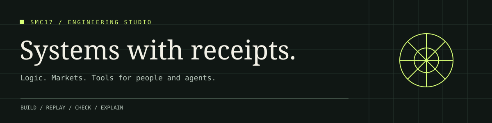

I’m **Sean Collins**. I build systems you can inspect: reasoning with checkable evidence, markets you can replay, and engineering workspaces that record what happened.

### Enter through a working question

| If you want to… | Start here | What to inspect |
| :--- | :--- | :--- |
| Check a reasoning result | **[logic-zig](https://github.com/SMC17/logic-zig)** | Named logical systems, SAT and model-checking engines, certificates, and explicit maturity levels |
| Follow a number back to its source | **[finance-segway](https://github.com/SMC17/finance-segway)** | Reproducible financial models and historical cases with source snapshots and workbook receipts |
| Record work by people and agents | **[zag](https://github.com/SMC17/zag)** | A Zig workbench with an event log, typed tool requests, and local policy decisions; Linux is the development platform |
| Understand a broken market-data feed | **[MarketDataSimulator](https://github.com/SMC17/MarketDataSimulator)** | A .NET exchange and recovery laboratory: matching, sequencing, explicit stale state, and deterministic replay |

### The thread

A claim should lead to an artifact. The artifact should lead to a command you can run.

These are research and development projects. Each repository owns its scope, limitations, and evidence; a prototype, a passing test, and a production system are different milestones.

### Start small

Try one example. Break one assumption. Bring the command, input, expected result, and actual result to the relevant repository’s issue tracker.

[Follow the work on GitHub](https://github.com/SMC17?tab=repositories) · [Find me on X](https://x.com/staxxxx17)

